# Архітектура: сторінки → API → сервіси → інфраструктура

Діаграма показує, як дані проходять через шари проєкту: сторінки в `app/[lang]/` або беруть дані напряму із сервісів через DI-контейнер (`app/di/container.ts`), або клієнтські компоненти викликають API-маршрути з `app/api/`, а ті звертаються до сервісів із `app/services/`. Сервіси залежать від репозиторіїв, а репозиторії — від Mongoose-моделей в `app/infrastructure/`. Суцільна стрілка — виклик, пунктирна — клієнтський `fetch` до API.

```mermaid
flowchart TD
    subgraph PAGES["app/[lang]/ — сторінки"]
        P_home["page.tsx (/)"]
        P_about["about-us/page.tsx"]
        P_bio["biography/page.tsx"]
        P_research["research/page.tsx"]
        P_privacy["privacy-policy/page.tsx"]
        P_coop["cooperation/page.tsx"]
        P_artistry["artistry/page.tsx"]
        P_archive["archive/page.tsx"]
        P_case["archive/[fund]/[case]/page.tsx"]
        P_news["news/page.tsx"]
        P_contacts["contacts/page.tsx"]
        P_support["support-us/page.tsx"]
        P_layout["layout.tsx (Header.server)"]
    end

    subgraph API["app/api/ — маршрути"]
        A_funds["api/funds/route.ts"]
        A_header["api/header/route.ts"]
        A_comp_data["api/compositions/data"]
        A_comp_filters["api/compositions/filters"]
        A_comp_titles["api/compositions/titles"]
        A_sci_data["api/scientific-works/data"]
        A_sci_filters["api/scientific-works/filters"]
        A_sci_titles["api/scientific-works/titles"]
        A_page["api/page/route.ts"]
        A_collab["api/collaboration/route.ts"]
    end

    subgraph SERVICES["app/services/"]
        S_pages["pages-data/pagesDataService.ts<br/>(+ resolvePageData.ts)"]
        S_funds["funds/fundsService.ts"]
        S_news["news/newsService.ts"]
        S_media["media-mentions/mediaMentionService.ts"]
        S_footer["footer/footerService.ts"]
        S_header["header/headerService.ts"]
        S_artistry["artistry/artistryService.ts"]
        S_sci["scientific-works/scientificWorks.ts"]
    end

    DI{{"app/di/container.ts<br/>modules/composedServices.module.ts<br/>modules/repositories.module.ts"}}

    subgraph REPOS["app/infrastructure/repositories/"]
        R_pages["pages-data/pagesData.repository.ts"]
        R_funds["funds/funds.repository.ts"]
        R_news["news/news.repository.ts"]
        R_media["media-mentions/mediaMention.repository.ts"]
        R_found["foundation-info/foundationInfo.repository.ts"]
        R_nav["navigation/navigation.repository.ts"]
        R_comp["artistry/compositions.repository.ts"]
        R_sci["scientific-works/scientificWorks.repository.ts"]
    end

    subgraph MODELS["app/infrastructure/models/"]
        M_pages["pages/pages.ts<br/>pages/draftPages.model.ts"]
        M_archive["archive/Fund.ts<br/>archive/Case.ts<br/>archive/Document.ts"]
        M_news["news/news.model.ts"]
        M_media["media-mentions/mediaMention.model.ts"]
        M_found["foundation-info/foundationInfoBranding.ts<br/>foundationInfoContact.ts<br/>foundationInfoPublic.ts"]
        M_nav["navigation/navigation.ts"]
        M_art["artistry/artistryTableData.ts<br/>artistryCategoriesData.ts<br/>artistryGenreData.ts<br/>artistryOpusData.ts"]
        M_sci["scientific-works/scientificWorksTableData.ts<br/>scientificWorksAuthor.ts"]
    end

    DB[("MongoDB<br/>app/infrastructure/db/connect.ts")]

    %% Сторінки → сервіси (серверний рендеринг через createRequestContainer)
    P_home --> S_pages
    P_about --> S_pages
    P_bio --> S_pages
    P_research --> S_pages
    P_privacy --> S_pages
    P_coop --> S_pages
    P_case --> S_funds
    P_news --> S_news
    P_news --> S_media
    P_contacts --> S_footer
    P_support --> S_footer
    P_layout --> S_header
    P_layout --> S_footer

    %% Сторінки → API (клієнтські fetch / table-хуки)
    P_archive -.->|"/api/funds"| A_funds
    P_artistry -.->|"MusicTableSection"| A_comp_data
    P_artistry -.-> A_comp_filters
    P_artistry -.-> A_comp_titles
    P_research -.->|"WorkTableSection"| A_sci_data
    P_research -.-> A_sci_filters
    P_research -.-> A_sci_titles
    P_contacts -.->|"OfferCollaborationForm"| A_collab

    %% API → сервіси
    A_funds --> S_funds
    A_header --> S_header
    A_comp_data --> S_artistry
    A_comp_filters --> S_artistry
    A_comp_titles --> S_artistry
    A_sci_data --> S_sci
    A_sci_filters --> S_sci
    A_sci_titles --> S_sci
    A_page --> S_pages

    %% Сервіси резолвляться через DI
    DI -.->|"створює"| SERVICES
    DI -.->|"створює"| REPOS

    %% Сервіси → репозиторії
    S_pages --> R_pages
    S_funds --> R_funds
    S_news --> R_news
    S_media --> R_media
    S_footer --> R_found
    S_footer --> R_nav
    S_header --> R_found
    S_header --> R_nav
    S_artistry --> R_comp
    S_sci --> R_sci

    %% Репозиторії → моделі
    R_pages --> M_pages
    R_funds --> M_archive
    R_news --> M_news
    R_media --> M_media
    R_found --> M_found
    R_nav --> M_nav
    R_comp --> M_art
    R_sci --> M_sci

    %% Моделі → БД
    MODELS --> DB
```

## Примітки

- Сторінки `about-us`, `biography`, `research`, `privacy-policy` та `/` отримують дані через `services/pages-data/resolvePageData.ts`, який обирає `pagesDataService` або `draftPagesDataService` залежно від draft mode.
- `archive/page.tsx` — клієнтський компонент: він викликає `/api/funds`, тоді як `archive/[fund]/[case]/page.tsx` бере `fundsService` напряму з контейнера.
- Таблиці на `/artistry` і `/research` ходять в API через клієнтські хуки та `services/client/tableService.ts`; маршрути визначені в `constants/routes/api-routes.ts`.
- `api/collaboration` і `api/contact` не використовують сервіси та БД: у навчальній версії вони лише валідують поля.
- Маршрути `api/header` і `api/page` існують, але зі сторінок напряму не викликаються (шапку в `layout.tsx` рендерить сервер через `headerService`).
