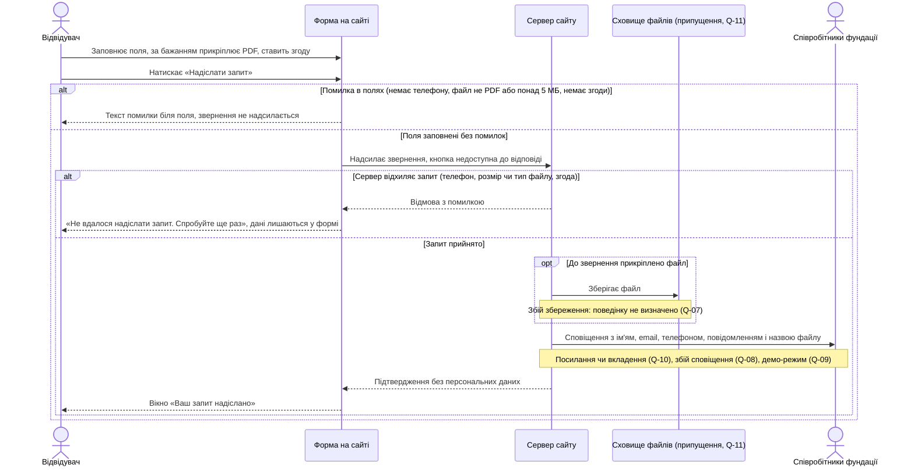

# Контактна форма: обов'язковий телефон і вкладення CV

Джерело: issue #2 «Contact form — update validation and notifications» і аналіз коду репозиторію.

## Короткий опис і вихідний запит

Фіча змінює форму звернення, яку відвідувачі заповнюють на сторінках «Контакти» (`/contacts`) і «Співпраця» (`/cooperation`). Телефон стає обов'язковим, а до звернення можна прикріпити документ: CV (резюме) або портфоліо. Сповіщення (лист співробітникам фундації про нове звернення) має показувати нові дані. Мета — щоб співробітники фундації отримували документи разом зі зверненням і швидше переходили до розмови з людиною.

Вихідний запит замовника (issue #2, дослівно):

> We want to tighten up the contact form. Phone number should be mandatory.
> We should also let visitors attach a document (CV or portfolio) when they write
> to us. Notifications need to reflect the new field.

Що є зараз (за кодом): у навчальній версії форма лише перевіряє поля. Співробітникам не надходить лист (RULE-36), а дані звернення ніде не зберігаються: маршрути `app/api/contact/route.ts` і `app/api/collaboration/route.ts` лише перевіряють поля й повертають відповідь, а телефон необов'язковий (RULE-09). Крім того, форма на сторінці «Співпраця» показує «Ваш запит надіслано», навіть коли запит завершився помилкою (RULE-42). <!-- edited -->

## Бізнес-контекст

> Бізнес-контекст вигаданий і не підтверджений: замовника грав AI-агент, ментор був недоступний (коментар «Business context» в issue #2).

**Ціль.** Швидше доводити звернення до живої розмови. Отримувати CV і портфоліо разом зі зверненням, а не окремими листами, які губляться.

**Метрика** (пропозиція аналітика, припущення):
- частка звернень із прикріпленим файлом;
- кількість ручних запитів «надішліть документи» на місяць до і після запуску.

Базових цифр «до» зараз немає. Хто їх збиратиме, невідомо (Q-21).

**Обмеження** (NFR — нефункціональні вимоги, тобто вимоги не до того, що робить форма, а до того, як вона це робить):
1. **NFR-1. Приватність.** Телефон і файл бачать лише 2–3 визначені співробітники фундації (Q-13).
2. **NFR-2. Зберігання.** CV не зберігаються безстроково. Термін і місце зберігання визначає юрист (Q-11, Q-12).
3. **NFR-3. Відповідність закону.** Можливо, доведеться оновити політику конфіденційності (Q-14).
4. **NFR-4. Доступність.** Обов'язковий телефон не має відлякувати іноземних партнерів (Q-04, Q-06, Q-17).

**Суперечності, які треба розв'язати:**
- Формат і розмір файлу. Замовник хоче PDF і Word до 10 МБ, технічна постановка — лише PDF до 5 МБ (Q-01).
- Замовник сумнівається, чи телефон має бути обов'язковим для всіх відвідувачів (Q-04).

## User stories

> US-01. Як відвідувач сайту, я хочу прикріпити CV або портфоліо до звернення, щоб не надсилати документи окремим листом.

> US-02. Як співробітник фундації, я хочу отримувати номер телефону в кожному зверненні, щоб швидше переходити до живої розмови.

> US-03. Як співробітник фундації, я хочу бачити в сповіщенні дані звернення і назву прикріпленого файлу, щоб не просити документи вручну.

> US-04. Як іноземний партнер, я хочу вказати міжнародний номер і бачити форму англійською, щоб надіслати звернення з-за кордону.

> US-05. Як відвідувач сайту, я хочу бачити, що звернення не вдалося надіслати, щоб не чекати відповіді на звернення, яке не дійшло.

> US-06. Як відвідувач сайту, я хочу, щоб мій телефон і CV бачили лише відповідальні співробітники фундації, щоб мої персональні дані не потрапили до сторонніх.

## Діаграма послідовності



Діаграма показує, як має працювати форма після зміни. Спершу форма сама перевіряє поля і з помилками звернення не надсилає. Потім сервер перевіряє все ще раз, бо запит можна надіслати й в обхід сайту. Прийняте звернення надходить співробітникам фундації як сповіщення, а відвідувач бачить вікно «Ваш запит надіслано». Якщо сервер відхилив запит, відвідувач бачить повідомлення про збій, а введені дані лишаються у формі. Де зберігати файл, як він потрапляє в сповіщення і що робити при збої сховища чи пошти, ще не вирішено (Q-07…Q-11). Сьогодні форма нічого не надсилає співробітникам (RULE-36).

Обмеження «PDF до 5 МБ» на діаграмі взято з технічної постановки, а замовник хоче PDF і Word до 10 МБ. Остаточне рішення чекає на Q-01. <!-- edited -->

## Таблиця правил

Як читати таблицю:
- **Шар** показує, де працює правило. UI — у формі, яку бачить відвідувач. API — на сервері, який приймає звернення. shared — у спільному коді, наприклад у шаблоні листа. Зовнішній — у сторонній службі.
- **Джерело істини** — місце в коді, де правило записане.
- Три стани правила:
  - «Є зараз» — як працює сьогодні;
  - «Має бути» — що вирішено змінити;
  - «Хто вирішив» — чиє це рішення.

  Останні два стовпці порожні, якщо рішення ще немає.

| ID | Правило простою мовою | Файл | Джерело істини | Шар (UI/API/shared/зовнішній) | Є зараз | Має бути | Хто вирішив |
|---|---|---|---|---|---|---|---|
| RULE-09 | Телефон можна не вказувати | `app/shared/components/forms/contact-form/ContactForm.tsx:49, 65`; `app/lib/utils/validateContactData.ts:7, 23` | UI: `z.literal('')` + `.optional()`; API: `if (phoneNumber)` | UI + API | Так, телефон необов'язковий | Обов'язковий | Замовник (Original request) |
| RULE-13 | У UI мінімальна довжина номера залежить від країни, максимальна — 16 цифр | `app/shared/hooks/use-handle-phone-input/useHandlePhoneInput.ts:8, 151–155` | `PHONE_COUNTRY_CODES[*].minPhoneLength` (`app/constants/phoneCountryCodes.ts`); локальна `PHONE_NUMBER_MAX_LENGTH = 16` | UI | Так | | |
| RULE-14 | API приймає лише формат `+цифри` довжиною 11–16 символів | `app/lib/utils/validateContactData.ts:24–29` | `regex.PHONE_NUMBER_PATTERN = /^\+\d+$/`, `lengths.PHONE_NUMBER_MIN_LENGTH` / `PHONE_NUMBER_MAX_LENGTH` (`app/constants/validation.ts:4–5, 12`) | API | Так. У UI мінімум залежить від країни, тут він фіксований, тож межі можуть розійтися | | |
| RULE-20 | Прикріпити документ (CV або портфоліо) неможливо | `app/shared/components/forms/contact-form/ContactForm.tsx:57–75` (у схемі форми немає поля файлу); рішення: issue #2, Original request | немає | — | Ні, поля немає | Можна прикріпити документ (CV або портфоліо) | Замовник (Original request) |
| RULE-23 | Сервер згоду не отримує і не перевіряє | `app/shared/components/forms/offer-collaboration-form/OfferCollaborationForm.tsx:35–40`; `app/lib/utils/validateContactData.ts:4–9` | у тілі запиту немає `policy` | API | Так. Згода існує лише в UI | | |
| RULE-30 | Для телефону є лише текст «Перевірте формат номера телефону», тексту «обов'язкове» немає | `i18n/messages/uk.json:43` | `phoneNumberInvalid` | UI | Так | | |
| RULE-33 | Якщо сервер відхиляє дані, він відповідає HTTP 400 з `{ success: false, errors }` | `app/lib/utils/apiResponse.ts`; `app/api/collaboration/route.ts:12`; `app/api/contact/route.ts:11` | `errorResponse(..., 400)` | API | Так | | |
| RULE-36 | Лист фундації не надсилається: маршрути не викликають `emailService`, а `sendEmail` — заглушка | `app/services/email/emailService.ts:11–13`; `app/api/contact/route.ts`; `app/api/collaboration/route.ts` | `return { success: true }` | shared / зовнішній | Так, листа немає | | |
| RULE-37 | Телефон потрапляє в лист, лише якщо його заповнили | `app/services/email/emails/emails.ts:19, 88`; `app/services/email/emails/emails.test.ts` | `phoneNumber ? ... : ''` | shared | Так | | |
| RULE-38 | У листі немає даних про вкладений документ | `app/services/email/emails/emails.ts` | `ContactEmailData` / `CollaborationEmailData` | shared | Ні | Лист показує нове поле | Замовник (Original request) |
| RULE-42 | Вікно «Ваш запит надіслано» з'являється, навіть коли запит завершився помилкою | `app/shared/components/forms/offer-collaboration-form/OfferCollaborationForm.tsx:48, 55–58`; `app/shared/components/forms/contact-form/ContactForm.tsx:109–110` | `catch` перехоплює помилку й не передає її далі | UI | Так | | |
| RULE-43 | Форма в модалці нот нічого не надсилає на сервер, лише показує підтвердження | `app/shared/components/get-notes-modal/GetNotesModal.tsx:64` | `onSubmit={() => setState(GetNotesState.CONFIRM)}` | UI | Так | | |
| RULE-49 | Факт згоди на обробку персональних даних ніде не зберігається: ні в листі, ні в логах, ні в базі | `app/shared/components/forms/offer-collaboration-form/OfferCollaborationForm.tsx:35–40`; `app/services/email/emails/emails.ts` | немає | UI + API | Так, згода не зберігається | | |
| RULE-50 | Розмір тіла запиту не обмежений, перевіряється лише довжина окремих полів | `app/api/contact/route.ts:6`; `app/api/collaboration/route.ts:7` | `request.json()` без ліміту | API | Так, обмеження немає | | |

Тут 14 правил, що стосуються запиту. Повний список RULE-01…RULE-50 — у коментарі «Rules table» в issue #2. Посилання на інші RULE і AC у критеріях, аналізі впливу та відкритих питаннях ведуть до повних списків в issue #2.

RULE-09 «Має бути: обов'язковий» взято з вихідного запиту. Бізнес-контекст цьому суперечить: замовник сумнівається, чи телефон потрібен усім (Q-04).

## Критерії приймання

Тут 15 ключових критеріїв з коментаря «Acceptance criteria» в issue #2, оформлені за Given/When/Then. Текст не змінено, крім AC-07: формат телефону виправлено на «11–16 символів разом із «+» (10–15 цифр)», як у коді. Решта критеріїв (англійські тексти, заміна й видалення файлу, стан під час надсилання, екранування в листі, журнали) — в issue #2. AC-23…AC-25 описують нову поведінку, для якої зараз немає правила.

### Основні сценарії

**AC-04 — Британський номер приймається**

```
Given відвідувач заповнив усі поля без помилок, поставив згоду і ввів британський номер +44 20 7946 0958
When він натискає «Надіслати запит»
Then з'являється вікно «Ваш запит надіслано»
```

Історія: US-04 · Правила: RULE-13, RULE-14 · Залежить від: Q-04, Q-17

**AC-09 — PDF рівно 5 МБ**

```
Given відвідувач заповнив усі поля без помилок, поставив згоду і прикріпив PDF розміром рівно 5 МБ
When він натискає «Надіслати запит»
Then з'являється вікно «Ваш запит надіслано»
```

Історія: US-01 · Правила: RULE-20 · Залежить від: Q-01, Q-02

**AC-30 — Вміст сповіщення**

```
Given звернення з прикріпленим файлом прийняте
When співробітник фундації відкриває сповіщення про нього
Then у сповіщенні є ім'я, email, телефон, повідомлення відвідувача і назва прикріпленого файлу
```

Історія: US-03 · Правила: RULE-37, RULE-38 · Залежить від: Q-10

**AC-32 — Хто отримує сповіщення**

```
Given звернення прийняте
When фундація отримує сповіщення про нього
Then сповіщення отримують тільки визначені співробітники фундації
```

Історія: US-06 · Правила: RULE-36 · Залежить від: Q-09, Q-13

### Порожні стани

**AC-08 — Звернення без файлу**

```
Given відвідувач заповнив усі поля без помилок, поставив згоду і не прикріпив файл
When він натискає «Надіслати запит»
Then з'являється вікно «Ваш запит надіслано»
```

Історія: US-01 · Правила: RULE-20

**AC-31 — Сповіщення про звернення без файлу**

```
Given звернення без файлу прийняте
When співробітник фундації відкриває сповіщення про нього
Then у сповіщенні зазначено, що файл не прикріплено
```

Історія: US-03 · Правила: RULE-38

### Сценарії з помилками

**AC-01 — Порожній телефон (UK)**

```
Given відвідувач заповнив усі поля, крім телефону, і поставив згоду
When він натискає «Надіслати запит»
Then під полем телефону з'являється текст «Вкажіть номер телефону»
```

Історія: US-02 · Правила: RULE-09, RULE-30 · Залежить від: Q-04

**AC-06 — Сервер: запит без телефону**

```
Given запит надходить в обхід сайту без телефону
When сервер його обробляє
Then сервер відхиляє запит з помилкою про телефон
```

Історія: US-02 · Правила: RULE-09, RULE-33 · Залежить від: Q-04

**AC-07 — Сервер: телефон у неправильному форматі** <!-- edited -->

```
Given запит надходить в обхід сайту з телефоном не у форматі «11–16 символів разом із «+» (10–15 цифр)»
When сервер його обробляє
Then сервер відхиляє запит з помилкою про формат телефону
```

Історія: US-02 · Правила: RULE-14, RULE-33 · Залежить від: Q-04, Q-17

**AC-10 — Завеликий файл (UK)**

```
Given форма відкрита українською
When відвідувач вибирає PDF розміром понад 5 МБ
Then під полем файлу з'являється текст «Файл має бути не більше 5 МБ»
```

Історія: US-01 · Правила: RULE-26, RULE-50 · Залежить від: Q-01, Q-02, Q-05

**AC-12 — Файл не PDF (UK)**

```
Given форма відкрита українською
When відвідувач вибирає файл .docx
Then під полем файлу з'являється текст «Можна прикріпити лише файл PDF»
```

Історія: US-01 · Правила: RULE-20, RULE-26 · Залежить від: Q-01, Q-05

**AC-15 — Сервер: файл понад 5 МБ**

```
Given запит надходить в обхід сайту з файлом розміром понад 5 МБ
When сервер його обробляє
Then сервер відхиляє запит з помилкою про розмір файлу
```

Історія: US-01 · Правила: RULE-33, RULE-50 · Залежить від: Q-01, Q-02

**AC-26 — Немає вікна успіху при збої**

```
Given надіслати звернення не вдалося
When надсилання завершилося
Then вікно «Ваш запит надіслано» не з'являється
```

Історія: US-05 · Правила: RULE-42 · Залежить від: Q-07, Q-08

**AC-29 — Дані лишаються у формі після збою**

```
Given відвідувач заповнив форму, прикріпив файл, а надіслати звернення не вдалося
When надсилання завершилося
Then усі введені дані та прикріплений файл лишаються у формі
```

Історія: US-05 · Правила: RULE-42 · Залежить від: Q-07

**AC-38 — Файл недоступний стороннім**

```
Given стороння людина знає адресу прикріпленого файлу
When вона відкриває цю адресу, не будучи визначеним співробітником фундації
Then файл не відкривається
```

Історія: US-06 · Правила: RULE-36 · Залежить від: Q-10, Q-11, Q-13

## Ключові файли й аналіз впливу

Головні файли і що вони означають для бізнесу:
- `app/shared/components/forms/contact-form/ContactForm.tsx` — сама форма: поля, тексти помилок, згода з політикою, вікно «Дякую». Ту саму форму використовує модалка нот (Q-16).
- `app/shared/components/forms/offer-collaboration-form/OfferCollaborationForm.tsx` — форма на сторінках «Контакти» і «Співпраця». Вона надсилає звернення на сервер.
- `app/api/collaboration/route.ts` — адреса на сервері (API — точка, куди сайт надсилає дані), яка приймає звернення з «Контактів» і «Співпраці».
- `app/api/contact/route.ts` — друга точка прийому звернень. Сайт зараз нею не користується.
- `app/lib/utils/validateContactData.ts` і `app/constants/validation.ts` — серверна перевірка полів і числові ліміти: довжина імені, повідомлення, телефону.
- `app/services/email/emailService.ts` і `app/services/email/emails/emails.ts` — підготовка сповіщення співробітникам. Зараз це заглушка (код, який нічого не робить), тож листи не надсилаються.
- `app/services/upload/upload.ts` — завантаження файлів. Теж заглушка.
- `i18n/messages/uk.json` і `i18n/messages/en.json` — усі тексти форми українською та англійською.

Аналіз впливу (з коментаря «Impact analysis» в issue #2):

| Зачеплена область | Тип зміни (нова/змінена/видалена) | Ризик (високий/середній/низький) | Рекомендована дія | Ідея регресійного тесту | Пов'язані RULE-ID |
|---|---|---|---|---|---|
| `app/shared/components/forms/contact-form/ContactForm.tsx`: схема телефону | змінена | високий | Прибрати `z.literal('')` і `.optional()`; некоректний номер має давати явну помилку, а не тихий `undefined` | Відправка без телефону блокується з текстом «обов'язкове»; неповний номер блокується; валідний номер `+380…` надсилається нормалізованим | RULE-09, RULE-11, RULE-15 |
| `app/shared/components/forms/contact-form/ContactForm.tsx`: поле файлу | нова | високий | Додати необов'язкове поле PDF до 5 МБ з перевіркою під час вибору; очищати файл після закриття модалки | Без файлу форма відправляється; PDF 5 МБ проходить; 5 МБ + 1 байт і `.docx` дають помилку одразу; після закриття «Дякую» поле файлу порожнє | RULE-20, RULE-25, RULE-26 |
| `app/shared/components/forms/contact-form/ContactForm.styles.ts` | змінена | низький | Додати стилі для поля файлу в межах наявної дизайн-системи | Візуальна перевірка: поле файлу у станах default, error і disabled | RULE-20 |
| `app/shared/components/get-notes-modal/GetNotesModal.tsx` | змінена (опосередковано) | середній | Вирішити, чи модалка нот отримує обов'язковий телефон і поле файлу; якщо ні, налаштувати це через props `ContactForm` | Модалка нот поводиться згідно з рішенням: є або немає поля файлу, телефон обов'язковий або ні | RULE-43 |
| `app/shared/components/forms/offer-collaboration-form/OfferCollaborationForm.tsx` | змінена | високий | Перейти з JSON на `FormData`; оновити тип даних; показувати помилку замість «надіслано», коли запит упав | Тіло запиту — `FormData` з полями та файлом; при відповіді 400 чи 500 вікно «Ваш запит надіслано» не з'являється | RULE-42, RULE-23 |
| `app/api/collaboration/route.ts` | змінена | високий | Читати `request.formData()`; перевіряти телефон і файл на сервері; викликати upload й email; не повертати файл і зайві поля у відповіді | Запит без телефону дає 400; не PDF дає 400; більше 5 МБ дає 400; валідний запит дає 200 без бінарних даних у відповіді | RULE-09, RULE-33, RULE-46, RULE-47, RULE-50 |
| `app/api/contact/route.ts` | змінена (опосередковано) | середній | Вирішити, чи додавати файл сюди; щонайменше врахувати обов'язковий телефон через спільну валідацію й додати `try/catch` | Запит без телефону дає 400; запит не в JSON дає 400 або 500 у форматі `{ success: false, errors }` | RULE-09, RULE-35 |
| `app/lib/utils/validateContactData.ts` | змінена | високий | Зробити телефон обов'язковим; додати перевірку файлу (тип, розмір, сигнатура `%PDF-`) або винести її в окрему функцію | Телефон `undefined` або `''` дає `PHONE_NUMBER_ERROR`; файл з `type: application/pdf`, але без `%PDF-`, відхиляється | RULE-09, RULE-14, RULE-20 |
| `app/lib/utils/validateRequestData.ts` | змінена | середній | Додати перетворення `FormData` в об'єкт; відкидати поля, яких немає в схемі | Зайве поле в запиті не потрапляє ні у відповідь, ні в лист | RULE-47 |
| `app/constants/validation.ts` | змінена | низький | Додати `FILE_MAX_SIZE` і дозволений MIME як єдине джерело для клієнта й сервера | Клієнт і сервер приймають і відхиляють той самий файл на межі 5 МБ | RULE-02, RULE-03, RULE-17, RULE-18, RULE-50 |
| `app/constants/errors.ts` | змінена | низький | Додати серверні помилки для відсутнього телефону, неправильного типу й завеликого файлу | Кожна помилка повертається своїм текстом у масиві `errors` | RULE-33, RULE-34 |
| `app/validators/blob.schema.ts` | змінена | низький | Перевикористати `zContentTypeSchema` для `application/pdf`; додати папку для вкладень у `zFolderNameSchema` | `zFolderNameSchema` приймає нову папку; наявні папки працюють як раніше | RULE-20 |
| `app/services/upload/upload.ts` | змінена | високий | Змінити сигнатуру `uploadFile`: приймати файл і повертати URL або ідентифікатор; у демо лишити заглушку | `uploadFile(file)` повертає непорожній ідентифікатор; `deleteFile` і `streamBlob` поводяться як раніше | RULE-20, RULE-38 |
| `app/services/email/emailService.ts` | змінена | високий | Додати `attachments` в `EmailOptions`; передавати згенерований лист у `sendEmail`; вирішити, чи лишається демо-режим | `sendCollaborationEmail` викликає `sendEmail` з html, text і вкладенням; маршрут справді викликає сервіс | RULE-36, RULE-38 |
| `app/services/email/emails/emails.ts` | змінена | середній | Показувати телефон завжди; додати блок вкладення (посилання або ім'я файлу); екранувати дані користувача | Лист завжди містить «Phone Number:»; ім'я файлу `<script>.pdf` у HTML екрановане; без файлу блок вкладення відсутній | RULE-37, RULE-38, RULE-40 |
| `app/api/blob-url/route.ts` | змінена | низький | Додати `.pdf` → `application/pdf` до мапи `contentTypes`, якщо файли віддаватимуться через цей маршрут | Запит PDF повертає `Content-Type: application/pdf`; зображення віддаються як раніше | RULE-20 |
| `app/lib/utils/validateContactData.test.ts` | змінена | середній | Оновити тест «valid input» на рядках 6–14: додати телефон; додати тести для відсутнього телефону й для файлу | Набір даних без телефону більше не валідний | RULE-09 |
| `app/shared/components/forms/contact-form/ContactForm.test.tsx` | змінена | середній | Оновити тест на рядках 106–115: заповнювати телефон; додати тести для поля файлу | Без телефону `onSubmit` не викликається; з телефоном викликається один раз | RULE-09, RULE-20 |
| `app/services/email/emails/emails.test.ts` | змінена | середній | Прибрати або змінити тести «without phone number»; додати тести вкладення й екранування | Тести падають, якщо телефон або вкладення зникають з листа | RULE-37, RULE-38, RULE-40 |
| `app/services/email/emailServise.test.ts` | змінена | низький | Оновити під нову сигнатуру з вкладенням | Сервіс приймає payload з `attachments` без помилки | RULE-36 |
| `app/services/upload/upload.test.ts` | змінена | низький | Оновити під `uploadFile(file)` з результатом | `uploadFile` повертає ідентифікатор замість `undefined` | RULE-20 |
| `app/api/collaboration/route.test.ts` і `app/api/contact/route.test.ts` | змінена | середній | Замінити моки `json()` на `formData()`; додати кейси для файлу | Маршрут читає `formData()`; файл понад 5 МБ дає 400 | RULE-33, RULE-50 |
| `app/shared/components/forms/offer-collaboration-form/OfferCollaborationForm.test.tsx` | змінена | середній | Перевіряти тіло `FormData`; виправити тест на рядку 118 під реальну поведінку з помилкою | При `!response.ok` вікно успіху не показується | RULE-42 |
| `i18n/messages/uk.json` і `i18n/messages/en.json` | змінена | низький | Додати зірочку до телефону, `phoneNumberRequired`, підпис і підказку для файлу, помилки «лише PDF» і «до 5 МБ»; спершу українською | Обидві локалі мають однаковий набір ключів `contactForm.*` | RULE-27, RULE-28, RULE-30, RULE-31 |
| Тексти політики конфіденційності (`/privacy-policy`) | змінена (за рішенням замовника) | середній | Узгодити із замовником, чи треба згадати обробку CV і портфоліо | — | RULE-24, RULE-49 |
| `app/infrastructure/models/` і `app/infrastructure/repositories/` | без змін | низький | Не змінювати, якщо не вирішено зберігати звернення, файли чи факт згоди | — | RULE-49 |
| `next.config.ts` | без змін | середній | Ліміт 5 МБ перевіряти в коді маршруту; поведінку body limit для route handlers у Next 15.4 уточнити в документації | Запит понад 5 МБ відхиляється з 400, а не обробляється повністю | RULE-50 |
| `.env.example` і `package.json` | змінена (лише для реальної пошти чи сховища) | середній | Додати змінні й залежності тільки якщо відмовляємося від демо-режиму | Застосунок стартує з `.env.example` без нових секретів у демо-режимі | RULE-36 |
| Захист від зловживань (капча, rate limit) | нова (за рішенням) | високий | Вирішити, чи потрібні капча й rate limit для маршруту з завантаженням файлів | Серія запитів з однієї адреси обмежується, якщо rate limit буде впроваджено | RULE-44, RULE-45 |

## Відкриті питання

Питання з коментаря «Open questions for the stakeholder» в issue #2. Ролі й дати — припущення. Блокери (питання, без відповіді на які не почати роботу) мають дату до 2026-11-27, решта — до 2026-12-04.

| Q-NN | Питання | Чому блокує | Хто відповідає (роль) | До якої дати | Пов'язані AC/RULE |
|---|---|---|---|---|---|
| Q-01 | **Числові межі.** Які файли приймаємо: лише PDF до 5 МБ, як у технічній постановці, чи PDF і Word до 10 МБ, як хоче замовник? | Від відповіді залежать перевірки типу й розміру, тексти помилок і підказка біля поля. Без неї критерії для файлу не перевірити | Керівниця фундації (припущення) | 2026-11-27 (припущення) | AC-09…AC-16, AC-20, AC-21; RULE-20, RULE-50 |
| Q-02 | **Числові межі.** «5 МБ» — це 5 000 000 чи 5 242 880 байт? | Без точної межі не перевірити, що файл рівно 5 МБ приймається, а на 1 байт більший відхиляється | Координаторка комунікацій (припущення) | 2026-11-27 (припущення) | AC-09, AC-10, AC-11, AC-15; RULE-50 |
| Q-03 | **Числові межі.** Скільки файлів можна прикріпити до одного звернення: один чи кілька? | Критерії зараз розраховані на один файл. Якщо файлів кілька, зміняться критерії заміни й видалення файлу та розмір запиту | Координаторка комунікацій (припущення) | 2026-11-27 (припущення) | AC-17, AC-18; RULE-20, RULE-50 |
| Q-04 | **Обсяг вимоги.** Чи телефон обов'язковий для всіх відвідувачів, чи лише для частини звернень? Замовник сумнівається, а обов'язковий телефон не має відлякувати іноземних партнерів (NFR-4) | Від відповіді залежить, чи потрібні всі критерії про обов'язковий телефон | Керівниця фундації (припущення) | 2026-11-27 (припущення) | AC-01…AC-07; RULE-09, RULE-30, RULE-31 |
| Q-05 | **Локалі.** Чи погоджуєте нові тексти українською й англійською: помилки телефону та файлу, підказку біля поля файлу, повідомлення про невдалу відправку? | Не блокує розробку: тексти можна замінити пізніше. Блокує реліз | Координаторка комунікацій (припущення) | 2026-12-04 (припущення) | AC-01, AC-03, AC-10…AC-13, AC-20, AC-21, AC-27, AC-28; RULE-27, RULE-28 |
| Q-06 | **Локалі.** Чи показувати біля поля телефону підказку про міжнародний формат з кодом країни, щоб іноземні партнери не помилялися (NFR-4)? | Не блокує: це уточнення інтерфейсу | Координаторка комунікацій (припущення) | 2026-12-04 (припущення) | AC-04; RULE-10, RULE-13 |
| Q-07 | **Режими збою.** Звернення заповнене правильно, але файл не вдалося зберегти. Відхиляємо все звернення чи приймаємо його без файлу? | Від відповіді залежить, що бачить відвідувач і що отримує фундація у разі збою | Координаторка комунікацій (припущення) | 2026-11-27 (припущення) | AC-26…AC-29, AC-40; RULE-42 |
| Q-08 | **Режими збою.** Звернення прийняте, але сповіщення співробітникам не надіслалося. Що бачить відвідувач і хто з фундації про це дізнається? | Без відповіді незрозуміло, вважати таке звернення успішним чи невдалим | Координаторка комунікацій (припущення) | 2026-11-27 (припущення) | AC-26, AC-32; RULE-36, RULE-42 |
| Q-09 | **Режими збою.** Навчальна версія зараз нічого не надсилає (демо-режим). Чи мають сповіщення реально надходити співробітникам? | Від відповіді залежить, чи можна перевірити AC-32 і чи потрібна справжня поштова інтеграція | Керівниця фундації (припущення) | 2026-11-27 (припущення) | AC-32; RULE-36 |
| Q-10 | **Зберігання.** Як файл потрапляє до співробітника: посиланням на файл чи вкладенням у лист? | Від відповіді залежить вміст сповіщення і те, чи потрібне окреме сховище | Координаторка комунікацій (припущення) | 2026-11-27 (припущення) | AC-30, AC-38; RULE-38 |
| Q-11 | **Зберігання.** Де зберігати файл: на диску сервера, у хмарному сховищі (blob) чи ніде, тобто лише вкладенням у листі? | Від відповіді залежать критерії доступу до файлу та його видалення, а також вимоги до інфраструктури | Юрист (припущення) | 2026-11-27 (припущення) | AC-38, AC-40; RULE-20, RULE-36 |
| Q-12 | **Приватність і термін зберігання.** Скільки зберігається CV і що з ним відбувається після цього терміну? Чи видаляється він автоматично? | Без терміну не спроєктувати зберігання й видалення. За бізнес-контекстом CV не можна зберігати безстроково (NFR-2) | Юрист (припущення) | 2026-11-27 (припущення) | AC-38, AC-40; RULE-20 |
| Q-13 | **Приватність і термін зберігання.** Хто саме ці 2–3 співробітники, які бачать телефон і файл (NFR-1), і хто вирішує, кому надати доступ? | Без списку не перевірити, що сповіщення й файл отримують лише вони | Керівниця фундації (припущення) | 2026-11-27 (припущення) | AC-32, AC-38; RULE-36 |
| Q-14 | **Приватність і термін зберігання.** Чи треба оновити політику конфіденційності через обробку CV і портфоліо (NFR-3)? | Не блокує розробку. Блокує реліз, якщо оновлення потрібне | Юрист (припущення) | 2026-12-04 (припущення) | RULE-24, RULE-49 |
| Q-15 | **Приватність і термін зберігання.** Чи потрібно фіксувати факт згоди: хто погодився, коли і з якою версією політики? | Не блокує розробку поточних критеріїв. Якщо відповідь «так», з'являться нові критерії | Юрист (припущення) | 2026-12-04 (припущення) | AC-22; RULE-23, RULE-49 |
| Q-16 | **Розбіжності з таблиці правил.** Та сама форма є в модалці нот, де нічого не надсилається на сервер. Чи має вона отримати обов'язковий телефон і поле файлу? | Не блокує форму на «Контактах» і «Співпраці», але без відповіді модалка нот зміниться разом з ними | Координаторка комунікацій (припущення) | 2026-12-04 (припущення) | RULE-43 |
| Q-17 | **Розбіжності з таблиці правил.** У формі мінімальна довжина телефону залежить від країни, а сервер вимагає щонайменше 11 символів разом із «+». Чи може форма пропустити номер, який сервер відхилить, і що тоді бачить відвідувач? | Не блокує: правило сервера погоджене. Але для іноземних номерів можлива відмова без зрозумілого пояснення (NFR-4) | Координаторка комунікацій (припущення) | 2026-12-04 (припущення) | AC-04, AC-07; RULE-13, RULE-14 |
| Q-18 | **Розбіжності з таблиці правил.** Форма й сервер перевіряють email за різними правилами. Яку адресу вважати правильною, якщо форма її приймає, а сервер відхиляє? | Не блокує цю зміну, але може призводити до втрачених звернень | Координаторка комунікацій (припущення) | 2026-12-04 (припущення) | RULE-07 |
| Q-19 | **Розбіжності з таблиці правил.** Пробіли на початку й у кінці не обрізаються: email з пробілом відхиляється, а сервер приймає ім'я чи повідомлення з самих пробілів. Чи обрізати пробіли автоматично? | Не блокує цю зміну | Координаторка комунікацій (припущення) | 2026-12-04 (припущення) | RULE-05, RULE-19, RULE-48 |
| Q-20 | **Розбіжності з таблиці правил.** Капчі й обмеження кількості запитів немає. Чи приймаємо цей ризик для форми, через яку тепер завантажуються файли? | Не блокує критерії, але без захисту форму легко використати для масового завантаження файлів | Керівниця фундації (припущення) | 2026-12-04 (припущення) | RULE-44, RULE-45, RULE-50 |
| Q-21 | Хто й звідки збере базові цифри для метрики «до» запуску: частку звернень із файлом і кількість ручних запитів «надішліть документи» на місяць? | Не блокує розробку. Без цифр «до» успіх зміни не оцінити | Координаторка комунікацій (припущення) | 2026-12-04 (припущення) | AC-30, AC-31; RULE-38 |
