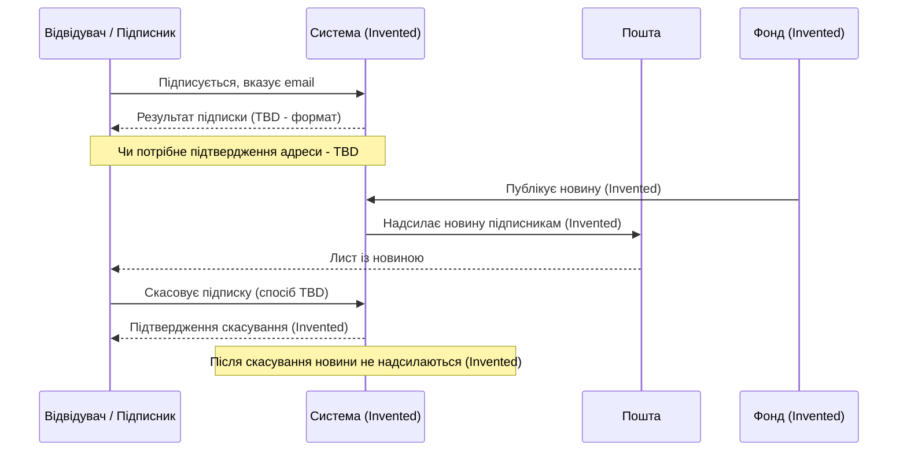

# Потрійне переписування: підписка на новини

> «Хочемо, щоб відвідувачі могли підписатися на новини Фонду електронною поштою. Підписку треба легко скасувати.»

## 1. AI-скан неоднозначностей

**Легенда міток:**
- **Explicit-in-text** — прямо сказано у вимозі, але формулювання допускає різні тлумачення.
- **Implied** — у тексті не сказано, але випливає з нього або з контексту репозиторію.
- **Missing** — у тексті немає й не випливає; потрібне рішення стейкхолдера.

**Контекст із репозиторію (факти, не рішення):**
- В «Умовах користування» (`app/shared/components/blocks/terms-of-use/terms.const..ts`, ключ `subscribeNews` у `i18n/messages/uk.json`) вже обіцяно право користувача «підписатися на розсилку новин Фундації (концерти, оновлення, події тощо)».
- У формі донату є перемикач «Підписка» / «Разовий внесок» (`donationForm.subscribeSwitch`, `donationForm.subscribeTitle`). Ймовірно, це регулярний внесок, а не розсилка, але назви збігаються.
- У вимозі сказано «Фонду», а на сайті організація називається «Фундація».
- Навчальна версія: форми лише перевіряють поля й нічого не надсилають; БД in-memory і очищається після перезапуску.

### 1.1. 10 неоднозначностей

| # | Категорія | Неоднозначність | Мітка |
|---|---|---|---|
| A1 | Актори | Хто такий «відвідувач»: будь-яка людина на сайті чи лише та, що вже донатила або писала через форму контактів? Чи можна підписати когось іншого (ввести чужу адресу)? | Explicit-in-text |
| A2 | Актори | Хто з боку Фундації отримує список підписників, керує ним і надсилає листи? Ролі адміністратора у вимозі немає. | Missing |
| A3 | Межі | Що таке «новини»: лише записи з розділу `/news` чи й концерти, події, оновлення архіву, збори коштів? В «Умовах» перелік ширший («концерти, оновлення, події тощо»). | Explicit-in-text |
| A4 | Межі | Де саме на сайті розміщено точку підписки: окрема сторінка, футер, `/news`, після донату, у формі контактів? | Missing |
| A5 | Межі | Чи входить у скоуп сама розсилка (створення й відправлення листів), чи лише збір адрес? У навчальній версії листи фізично не надсилаються. | Missing |
| A6 | Правила | Чи потрібне підтвердження адреси (лист із посиланням) перед активацією підписки, чи вона діє одразу після введення email? | Missing |
| A7 | Правила | Що означає «легко скасувати»: один клік із листа, сторінка відписки, відписка без входу/пароля, форма на сайті? Скільки кроків вважається «легко»? | Explicit-in-text |
| A8 | Дані | Які дані збираємо, крім email: ім'я, мову (uk/en), теми інтересів, дату та джерело підписки? Яка мова листів для підписника з англомовної версії? | Missing |
| A9 | Приватність | Чи потрібна явна згода (чекбокс) і посилання на `/privacy-policy`? Скільки зберігаємо дані після відписки й чи видаляємо їх? Чи треба оновити текст політики конфіденційності? | Missing |
| A10 | Залежності | Через який сервіс відправляти листи і де зберігати підписників? Як це поєднати з навчальним режимом (in-memory БД, форми нічого не надсилають)? | Implied |

### 1.2. 5 неявних припущень стейкхолдерів

| # | Припущення | Чому так вважаємо | Мітка |
|---|---|---|---|
| H1 | Фундація вже має (або матиме) регулярний контент для розсилки й людину, яка його готуватиме. | Без контенту підписка не має сенсу, але у вимозі про частоту чи відповідального нічого немає. | Implied |
| H2 | Підписка працює двома мовами, як і весь сайт. | Сайт двомовний (`uk`, `en`), але у вимозі про мову ні слова. | Implied |
| H3 | Підписуватися можна без акаунта й без входу на сайт. | На сайті немає реєстрації користувачів; «відвідувач» звучить як анонімна людина. | Implied |
| H4 | «Підписка на новини» у вимозі — те саме, що «розсилка новин», обіцяна в «Умовах користування», і не має стосунку до перемикача «Підписка» у формі донату. | У репозиторії однаковий термін вживається у двох різних значеннях. | Implied |
| H5 | Відписка — лише зупинка листів, без вимоги видалити всі дані людини. | Вимога каже «скасувати», а не «видалити дані»; що відбувається з адресою після відписки, не сказано. | Missing |

### 1.3. 5 питань для 30-хвилинної сесії

| # | Питання | Закриває | Мітка |
|---|---|---|---|
| Q1 | Що саме отримуватиме підписник (які типи новин), хто й як часто це готуватиме? | A3, A5, H1 | Missing |
| Q2 | Де на сайті людина бачить пропозицію підписатися і які дані ми в неї просимо, крім email? | A1, A4, A8 | Missing |
| Q3 | Чи підтверджує людина адресу перед активацією, і як має виглядати «легка» відписка з погляду Фундації (з листа, на сайті, скільки кроків)? | A6, A7 | Explicit-in-text |
| Q4 | Яка згода потрібна, як довго зберігаємо адресу після відписки і хто погоджує зміни в політиці конфіденційності? | A9, H5 | Missing |
| Q5 | Хто керує списком підписників і через який інструмент надсилаються листи? Що з цього потрібно показати в навчальній версії, де нічого не надсилається? | A2, A5, A10 | Missing |

## 2. Формат A: BA story

> Цей розділ заповнено лише за текстом вимоги, без контексту репозиторію і без результатів розділу 1.
> **TBD** означає, що у вимозі такої інформації немає. **Invented** означає, що формулювання довелося вгадати.

**ID запиту:** TBD  
**Джерело:** вимога стейкхолдера: «Хочемо, щоб відвідувачі могли підписатися на новини Фонду електронною поштою. Підписку треба легко скасувати.»  
**Дата:** TBD

---

### Короткий опис

Відвідувач може залишити свою електронну адресу, щоб отримувати новини Фонду поштою. Від розсилки має бути легко відписатися. Що саме входить у «новини», як часто вони надходять і як має виглядати «легко скасувати», у вимозі не сказано: TBD.

### Користувацькі історії

#### Історія 1
**Як** відвідувач  
**Я хочу** підписатися на новини Фонду електронною поштою  
**Щоб** отримувати новини Фонду на свою пошту _(Invented: мету вимога не формулює, «щоб» виведено з самої дії)_

**Критерії приймання (чернетка):**
- [ ] Відвідувач може вказати свою електронну адресу і підписатися на новини Фонду.
- [ ] Після підписки відвідувач отримує новини Фонду на вказану адресу. _(Invented: вимога не каже, коли саме й що саме надходить)_
- [ ] Де розміщено точку підписки, які дані збираємо, крім email, і чи потрібне підтвердження адреси: TBD.

#### Історія 2
**Як** підписник  
**Я хочу** легко скасувати підписку  
**Щоб** більше не отримувати новин Фонду поштою _(Invented: мету виведено з дії)_

**Критерії приймання (чернетка):**
- [ ] Підписник може скасувати підписку.
- [ ] Скасування «легке». Що це означає (кількість кроків, канал, чи потрібно щось вводити): TBD.
- [ ] Після скасування підписник більше не отримує новин. _(Invented: у вимозі прямо не сказано, але це звичайне розуміння «скасувати»)_

### Припущення

- «Відвідувач» означає людину, яка відвідує ресурси Фонду (Invented: де саме, у вимозі не сказано).
- «Новини Фонду» існують і надходитимуть із певною частотою (Invented: тип і частота TBD).
- Для підписки достатньо електронної адреси (Invented: інших даних вимога не згадує, але й не забороняє).

### Поза межами (неформально)

- TBD: межі у вимозі не визначено.

### Відкриті питання

| № | Питання | Власник | Потрібно до |
|---|---------|---------|-------------|
| 1 | Що саме входить у «новини Фонду» і як часто їх надсилатимуть? | TBD | TBD |
| 2 | Де і як відвідувач підписується? | TBD | TBD |
| 3 | Що конкретно означає «легко скасувати»? | TBD | TBD |
| 4 | Чи потрібно підтверджувати електронну адресу? | TBD | TBD |
| 5 | Які дані, крім email, збираємо і як довго їх зберігаємо? | TBD | TBD |

### Залежності

- TBD: у вимозі залежностей не названо. Для розсилки потрібен якийсь спосіб відправляти листи (Invented: механізм не вказано).

### Нотатки / ризики

- Слово «легко» не можна виміряти, доки його не визначать. Без цього критерій приймання історії 2 неможливо перевірити.
- Вимога не згадує ні згоду на обробку персональних даних, ні строк їх зберігання: TBD.

---

**Рефлексія:** Формат дозволив сховати відсутність мети: «Щоб…» довелося дописати самому (Invented), і він виглядає переконливо, хоча стейкхолдер мети не називав. Відкриті питання легко записати, але їх важко простежити, бо стовпці «Власник» і «Потрібно до» лишилися TBD і не пов'язані з конкретними критеріями приймання. Розділ «Поза межами» залишився порожнім, і формат на це ніяк не сигналізує.

## 3. Формат B: Spec Kit

> Цей розділ заповнено лише за текстом вимоги, без контексту репозиторію і без результатів розділів 1–2.
> **TBD** означає, що у вимозі такої інформації немає. **Invented** означає, що формулювання довелося вгадати.

---

### Product brief

#### Проблема
- **Кого стосується:** відвідувачів, а також Фонду як відправника новин.
- **Який біль:** TBD. Вимога описує бажане рішення («хочемо, щоб…»), а не проблему. Припущення, що відвідувачам зараз немає як отримувати новини Фонду поштою, Invented.
- **Чому зараз:** TBD.

#### Цільові користувачі
- Відвідувачі, які хочуть отримувати новини Фонду електронною поштою. Хто саме вважається «відвідувачем» (відвідувач чого саме, будь-хто чи певна група): TBD.
- Підписники, які хочуть скасувати підписку.

#### Метрики успіху
| Метрика | Ціль | Вимірювання |
|---------|------|-------------|
| TBD: вимога метрик не називає | TBD | TBD |

#### Не цілі (non-goals)
- TBD: у вимозі не названо.

---

### Constitution (принципи й обмеження)

| ID | Принцип / обмеження | Обґрунтування |
|----|---------------------|---------------|
| C-01 | Канал доставки новин — електронна пошта. | Прямо сказано у вимозі: «електронною поштою». Чи можливі інші канали: TBD. |
| C-02 | Скасувати підписку має бути легко. | Прямо сказано у вимозі: «Підписку треба легко скасувати». Як вимірювати «легко»: TBD. |

---

### Специфікація

#### Функціональні вимоги

| ID | Вимога | Пріоритет | Сигнал приймання |
|----|--------|-----------|------------------|
| FR-01 | Відвідувач може підписатися на новини Фонду, вказавши свою електронну адресу. | Must _(Invented: пріоритет у вимозі не вказано)_ | Відвідувач підписався, і його адреса потрапила до списку отримувачів новин. _(Invented: як саме фіксується підписка, вимога не каже)_ |
| FR-02 | Підписник може скасувати підписку. | Must _(Invented: вимога каже «треба», але пріоритету не ставить)_ | Після скасування підписник більше не отримує новин. _(Invented)_ Критерій «легко»: TBD. |
| FR-03 | Підписник отримує новини Фонду на свою електронну адресу. | TBD | TBD: що вважається «новиною», як часто й у якій формі її надсилають, не визначено. _(Invented: вимога прямо не каже, що відправлення входить у скоуп)_ |

#### Бізнес-правила

| ID | Правило | Виняток |
|----|---------|---------|
| BR-01 | Для підписки використовується електронна адреса. | TBD |
| BR-02 | Скасувати підписку може будь-який підписник. _(Invented: вимога не обмежує, хто може скасувати)_ | TBD |

#### Межі

**У межах**
- Підписка відвідувача на новини Фонду електронною поштою.
- Скасування підписки.

**Поза межами**
- TBD: у вимозі не визначено.

#### Актори й потоки

```text
(Відвідувач) → (вводить email і підписується) → (система) → (адресу додано до підписників)    [Invented: кроки потоку]
(Фонд)       → (публікує новину)              → (система) → (новину надіслано підписникам)    [Invented: актор «Фонд» і потік відправлення]
(Підписник)  → (скасовує підписку)            → (система) → (новини більше не надходять)      [Invented: кроки потоку; спосіб скасування TBD]
```

#### Залежності
- TBD: у вимозі не названо. Потрібен якийсь спосіб надсилати електронні листи (Invented: механізм не вказано).

#### Відкриті питання
| ID | Питання | Що блокує |
|----|---------|-----------|
| Q-01 | Яку проблему розв'язує підписка і чому вона потрібна саме зараз? | Product brief: «Проблема», метрики успіху |
| Q-02 | Як вимірювати успіх фічі? | Метрики успіху, чекліст передачі |
| Q-03 | Що саме входить у «новини Фонду» і як часто їх надсилатимуть? | FR-03 |
| Q-04 | Що конкретно означає «легко скасувати»? | C-02, сигнал приймання FR-02 |
| Q-05 | Хто такий «відвідувач» і де саме він підписується? | Цільові користувачі, FR-01 |
| Q-06 | Чи потрібно підтверджувати адресу, які дані збираємо і як довго їх зберігаємо? | FR-01, BR-01 |
| Q-07 | Що навмисно лишається поза межами? | Межі, Non-goals |

---

### Чекліст передачі

- [ ] Проблему й метрики успіху погоджено зі стейкхолдером: ні, обидва TBD (Q-01, Q-02).
- [ ] Поза-межами переглянуто з Product / Support: ні, межі TBD (Q-07).
- [ ] Відкриті питання мають власників: ні, у шаблоні немає стовпця для власника, тому власник TBD.
- [ ] Готово до refinement / технічного дослідження (spike): ні, блокують Q-01–Q-07.

---

**Рефлексія:** GitHub-нативними відчулися функціональні вимоги з ID і сигналами приймання, чекліст передачі та потоки в блоці `text`. Ці частини легко перенести в issue або опис PR. Суто аналітичними відчулися Product brief (проблема, метрики, non-goals) і Constitution. Саме вони майже повністю залишилися TBD, бо вимога описує рішення, а не проблему. Формат на відміну від A прямо показує прогалини: порожні метрики й непройдений чекліст видно одразу. В опис PR я б додав посилання на FR-ID, які PR реалізує, перелік відкритих Q-ID, від яких PR залежить, і явну примітку, що пріоритети та сигнали приймання поки Invented.

## 4. Формат C: OpenSpec / BMAD

> Цей розділ заповнено лише за текстом вимоги, без контексту репозиторію і без результатів розділів 1–3.
> **TBD** означає, що у вимозі такої інформації немає. **Invented** означає, що формулювання довелося вгадати.

---

### Метадані пакета

| Поле | Значення |
|------|----------|
| ID пакета | TBD |
| Можливість (capability) | Підписка на новини Фонду електронною поштою |
| Статус | Відкриття _(Invented: вимога статусу не вказує; обрано за тим, що є лише сира вимога)_ |
| Власник | TBD |

---

### Модуль 1. Місія й результат (стиль BMAD)

**Місія:** дати відвідувачам змогу підписатися на новини Фонду електронною поштою і легко скасувати підписку.  
**Бажаний результат:** відвідувач, який підписався, отримує новини Фонду поштою. Підписник, який вирішив відмовитися, легко скасовує підписку. _(Invented: вимога описує можливість, а не результат; результат виведено з неї)_  
**Критерії успіху:**

| ID | Критерій | Спостережуваний сигнал |
|----|----------|------------------------|
| SC-01 | Відвідувач може підписатися на новини електронною поштою. | TBD: як спостерігати успішну підписку, у вимозі не сказано. |
| SC-02 | Підписку легко скасувати. | TBD: «легко» не визначено, тож сигналу немає. |
| SC-03 | Бізнес-метрика успіху (наприклад, кількість підписників). | TBD: вимога метрик не називає. _(Invented: приклад метрики лише ілюструє тип, ціль не ставиться)_ |

---

### Модуль 2. Межі (стиль OpenSpec)

#### У межах
| ID | Пункт |
|----|-------|
| IN-01 | Підписка відвідувача на новини Фонду електронною поштою. |
| IN-02 | Скасування підписки. |
| IN-03 | Надсилання новин підписникам. _(Invented: вимога прямо не каже, що надсилання входить у пакет)_ |

#### Виключення
| ID | Виключення | Причина |
|----|------------|---------|
| OUT-01 | TBD | TBD: у вимозі виключень немає. |

---

### Модуль 3. Актори й потік

| Актор | Роль |
|-------|------|
| Відвідувач | Підписується на новини, вказуючи свою електронну адресу. |
| Підписник | Отримує новини і може скасувати підписку. |
| Фонд | Джерело новин. Хто саме з боку Фонду публікує і надсилає новини: TBD. _(Invented: як окремий актор Фонд у вимозі не названий)_ |
| Система | Приймає підписку, зберігає адресу, надсилає новини, обробляє скасування. _(Invented: де і як працює система, у вимозі не сказано)_ |



---

### Модуль 4. Бізнес-правила (перевірювані)

| ID | Коли | Тоді | Інакше |
|----|------|------|--------|
| RULE-01 | Відвідувач вказує електронну адресу і підписується | Адресу додано до отримувачів новин Фонду _(Invented)_ | TBD: що відбувається з некоректною чи вже підписаною адресою, не визначено. |
| RULE-02 | Підписник скасовує підписку | Підписник більше не отримує новин _(Invented)_ | TBD |
| RULE-03 | Підписник хоче скасувати підписку | Скасування доступне й «легке» | TBD: «легко» не визначено, тому правило поки неможливо перевірити. |

---

### Модуль 5. Обмеження й залежності

| ID | Тип | Опис |
|----|-----|------|
| DEP-01 | Технічна | Потрібен спосіб надсилати електронні листи. _(Invented: механізм у вимозі не вказано)_ |
| CON-01 | Юридичне / політика | TBD: вимога не згадує ні згоду на обробку персональних даних, ні строк зберігання адрес, ні правила розсилки. |
| CON-02 | Продуктове | Канал доставки — лише електронна пошта. Прямо сказано у вимозі. Чи можливі інші канали: TBD. |

---

### Модуль 6. Припущення й відкриті питання

| ID | Припущення | План перевірки |
|----|------------|----------------|
| ASM-01 | Для підписки достатньо електронної адреси. _(Invented)_ | Підтвердити зі стейкхолдером (Q-03). |
| ASM-02 | Фонд має новини, які регулярно надсилатиме. _(Invented: тип і частота TBD)_ | Підтвердити зі стейкхолдером (Q-01). |
| ASM-03 | Скасування означає, що листи припиняються. Що відбувається з самою адресою, невідомо. _(Invented)_ | Підтвердити зі стейкхолдером (Q-04). |

| ID | Питання | Стейкхолдер |
|----|---------|-------------|
| Q-01 | Що входить у «новини Фонду», хто їх готує і як часто надсилає? | TBD |
| Q-02 | Що конкретно означає «легко скасувати»? | TBD |
| Q-03 | Хто такий «відвідувач», де він підписується і які дані, крім email, ми збираємо? | TBD |
| Q-04 | Чи потрібна згода й підтвердження адреси, як довго зберігаємо адресу після скасування? | TBD |
| Q-05 | Як вимірюємо успіх і що навмисно виключено з пакета? | TBD |

---

### Матриця простежуваності (стартова)

| ID правила | Пов'язаний AC / історія | Ідея тесту |
|------------|-------------------------|------------|
| RULE-01 | SC-01, IN-01 | Підписатися з коректною адресою і перевірити, що вона з'явилася серед отримувачів. Поведінка для некоректної чи повторної адреси: TBD. |
| RULE-02 | SC-02, IN-02 | Скасувати підписку і перевірити, що наступна новина на цю адресу не надходить. |
| RULE-03 | SC-02, IN-02 | TBD: тест неможливо сформулювати, доки не визначено «легко» (Q-02). |

---

**Рефлексія:** Прогалини щодо **зберігання даних** першим виявив Модуль 5: рядок CON-01 «Юридичне / політика» обов'язковий у шаблоні, а заповнити його з вимоги нічим. Прогалини щодо **обіцянок стейкхолдерів** першими виявили Модулі 1 і 4. Обіцянку «легко скасувати» неможливо перетворити ні на спостережуваний сигнал (SC-02), ні на перевірюване правило (RULE-03), і матриця простежуваності це підтверджує порожньою ідеєю тесту. Дизайнер, прочитавши лише Модуль 3, зрозумів би акторів і загальний потік. Але він не зміг би узгодити екрани: діаграма показує, що підтвердження адреси, формат відповіді та спосіб скасування лишаються TBD, а частина кроків Invented. Тож йому однаково знадобилися б Модулі 4 і 6.

## 5. Порівняння форматів <!-- edited -->

| Формат | Де першу прогалину виявив ★ | Що приховав | Що найважче простежити | Кому зручний |
|---|---|---|---|---|
| A: BA story | ★ Історія 1, рядок «Щоб…»: мети у вимозі немає, і формат змусив її вигадати (Invented) | Приватність: згода й строк зберігання є лише у «Відкритих питаннях» і «Нотатках» наприкінці. «Поза межами» лишилось порожнім, і формат на це не вказує | Звідки взявся кожен критерій: у критеріях немає ID і правил | Product: читається як звичайний текст |
| B: Spec Kit | ★ Product brief, «Проблема»: «Який біль: TBD». Формат одразу вимагає проблему, а вимога описує рішення | Приватність: у Constitution немає принципу про персональні дані, а згода й зберігання сховані в одному питанні Q-06 разом із підтвердженням адреси | Пріоритети FR і сигнали приймання: усі Invented, і з таблиці не видно, на чому вони тримаються | Інженери: FR і чекліст передачі |
| C: OpenSpec / BMAD | ★ Модуль 1, критерії успіху: SC-01 і SC-02 без спостережуваного сигналу, бо «легко» не визначено | Найменше: обов'язковий рядок CON-01 «Юридичне / політика» змусив записати прогалину про згоду й зберігання | RULE-03 «легко скасувати»: у матриці немає ідеї тесту | AI та інженери: модулі з ID і матриця |

### Обговорення

- **Який формат «сховав» правило про приватність?** Spec Kit (B): у принципах про персональні дані нічого немає, питання є лише одне (Q-06), і воно змішане з іншими. Найкраще приватність показав формат C завдяки обов'язковому рядку CON-01.
- **Де межі з'явилися без запиту?** У B (FR-03) і C (IN-03): обидва додали «надсилання новин», хоча вимога каже лише про підписку й відписку. В A межі порожні, і формат на це не вказує.
- **Який формат я вставив би в AI-інструмент і чому?** C: кожен пункт має ID (IN, CON, SC, RULE), юридичний рядок обов'язковий, а матриця одразу показує правило без тесту. На такі ID AI може посилатися, і їх можна перевірити.
- **Що мене здивувало:** вільний AI-скан (розділ 1) знайшов приватність (A9, Q4) раніше, ніж будь-який шаблон. Шаблон показує лише ті прогалини, для яких у ньому є рядок.
